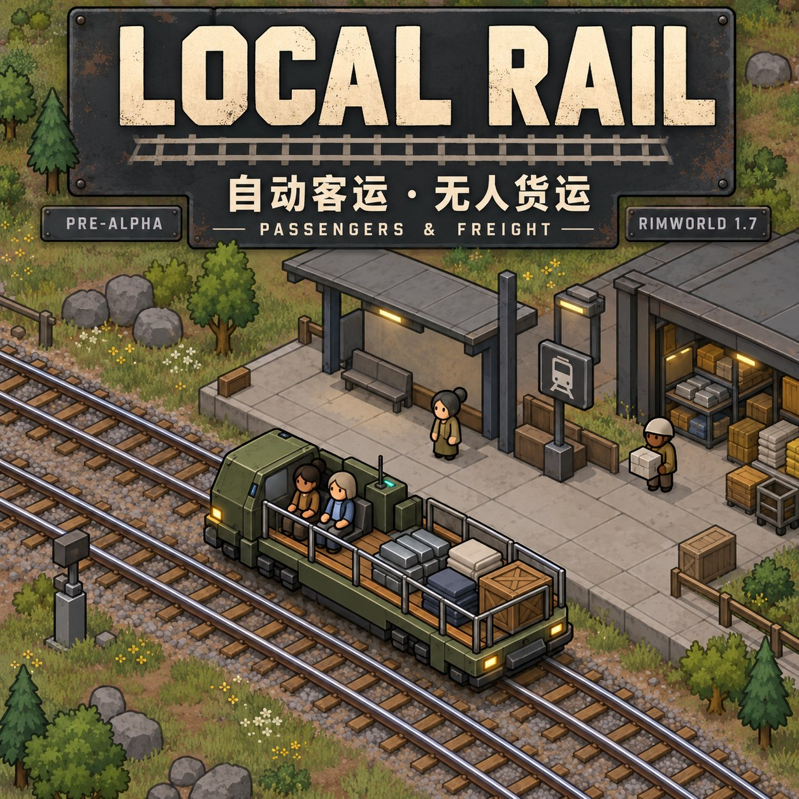
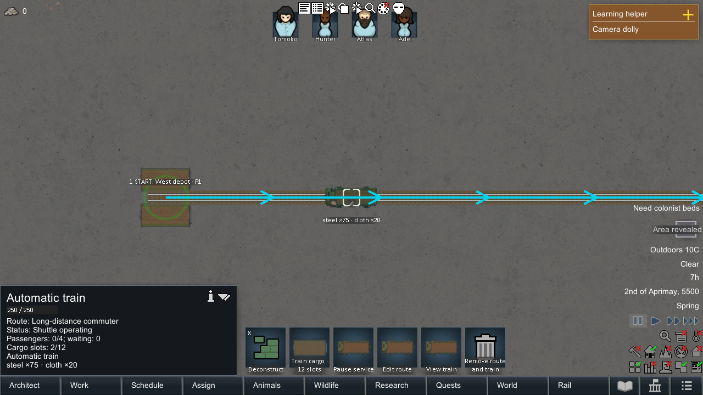
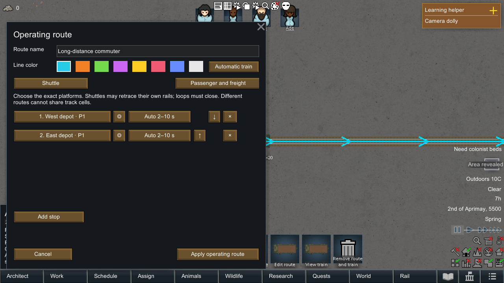

# Local Rail

**Automatic passenger and freight transport for RimWorld 1.7 · 0.10.0 Pre-Alpha**

[简体中文](docs/README.zh-CN.md) · [Player guide / 玩家指南](docs/22-player-guide.zh-CN.md) · [Workshop publishing material](docs/workshop/publishing-notes.zh-CN.md)

<p align="center">
  
</p>

*AI-generated promotional artwork. See the in-game screenshots below for the current implementation.*

Connect homes, farms, mines, and warehouses with a railway on one colony map. Colonists automatically board suitable trains during supported long-distance jobs and continue their work after arrival. Automatic trains also deliver warehouse inventory with nobody aboard.

This is a playable **Pre-Alpha**. Core transport and save/load behavior have been tested, while artwork, balance, interaction, and compatibility remain in development.

## Features

- Automatic commuting for player-controlled human colonists, including resources they are carrying.
- One permanent train per route, with **four seats and twelve cargo stack slots**.
- **Ordinary trains** for passengers and manually deposited freight; **automatic trains** also collect warehouse inventory, with mixed or freight-only modes. Both operate without a driver.
- Rotatable **one-, two-, and four-platform** passenger stations and freight warehouses.
- **2–16 stop** shuttles and physically closed loops, route names/colors, direction arrows, and exact platform selection.
- A bottom **Rail** management tab for creating, editing, locating, pausing, and removing routes.
- Typed dwell times or automatic minimum/maximum dwell, plus colonist travel diagnostics.
- Warehouse default destinations and item-based dispatch rules. Full or rejecting destinations keep cargo aboard for another visit and notify without pausing.
- Straight and diagonal rails, double-track modules, and metallic single/double-track automatic doors.
- Actual cargo icons, counts, passenger names, and a twelve-slot cargo window.

## Requirements and installation

- **RimWorld 1.7**. Tested on **1.7.4977 rev1248 / Waylith CLR 10.0.10** on Windows.
- [Harmony](https://steamcommunity.com/sharedfiles/filedetails/?id=2009463077), with its 1.7 assembly. Load it before Local Rail.
- No DLC or additional vehicle framework required. English and Simplified Chinese are included.

For a packaged copy, extract `LocalRail-0.10.0-rw1.7-poc.zip` and place its `LocalRail` folder in `<RimWorld>/Mods/`. Enable Harmony and Local Rail in the game's Mods menu, then restart the game. The ZIP is created in `dist/` by the build script; that directory is excluded from Git.

For a source checkout, build first and install the resulting `Mod/LocalRail` folder. The optional `install.ps1` helper is for a fresh installation and refuses to overwrite an existing mod directory.

## Quick start

### Passenger service

1. Build at least two stations under **Misc**, then connect the ends of their chosen platform tracks. Stations and rail doors already include rails; do not duplicate tracks inside their footprints.
2. Open **Rail**, create a route, choose stations and exact platforms in order, and select a train type, name, and color.
3. Choose a shuttle or loop. A loop needs an actual connection from its last stop back to its first; shuttles may retrace their own track segments.
4. Confirm the route. Enable automatic travel and rail preference in mod settings. Eligible undrafted colonists will approach, wait, and board automatically.
5. If a colonist keeps walking, open their **Rail travel decision** diagnostic. Station access defaults to **80 tiles** and is adjustable; job eligibility, safe access, and waiting costs still matter.

### Unmanned freight

1. Create a route serving freight warehouses and select an **Automatic train**.
2. Set the sending warehouse's **Default inventory destination** to a platform on that route. Use dispatch rules for item-specific or multiple destinations.
3. Colonists haul resources into the warehouse through normal hauling work. The train collects stock during stops, even with zero passengers.
4. Cargo unloads at its designated platform, respecting filters and capacity. Received cargo is not automatically re-exported by default; colonists can haul it into suitable ordinary storage.

## Current scope and limitations

| Area | Current behavior |
| --- | --- |
| Construction | Tracks, passenger stations, and warehouses have no resource cost but require construction work. Metallic rail doors cost materials. No power, fuel, or research requirements yet. |
| Track sharing | One train per route. Different routes cannot share track cells. Platforms connect independently and need real outside tracks to switch lines. |
| Travel scope | One colony map. No world-map rail, automatic route transfers, shared-track signaling, passing traffic, or multiple trains per route. |
| Boarding | Supported job movement only. Drafted, downed, or mentally affected pawns, map-exit jobs, and carrying living pawns are excluded. Unsuitable access or waiting costs may still favor walking. |
| Collision and topology | Full-width train collision is not implemented. Rail doors allow horizontal/vertical passages. Some complex multi-loop stop orders may be rejected by current path selection. |
| Compatibility | Main features tested with Core and Harmony. Other job/pathfinding/vehicle mods and large mod collections are not comprehensively tested. |

## Save compatibility and backups

Routes and cargo in transit support saving and loading. A **0.9 save upgraded to 0.10** has been tested. Adding to arbitrary existing saves, downgrading, and removal have not been comprehensively tested. Future Pre-Alpha updates may change definitions or save data; lossless migration of every old save is not guaranteed.

**Before first adding, updating, or removing the mod, make a separate manual backup outside your autosave rotation.** Test on a copy and retain game/mod versions and your mod list. Avoid removing the mod while rail buildings, passenger trips, or cargo in transit remain. Clearing those does not establish that uninstalling is safe.

## In-game screenshots

The following captures come from isolated in-game validation maps, with development overlays visible:

| Empty automatic train carrying stock | Route editor and train types |
| --- | --- |
|  |  |

[Travel diagnostic](Validation/rail-travel-diagnostic.png) · [Rotatable station layouts](Validation/rail-rotated-stations.png)

## Build from source

The current project targets **`net10.0`**. Use a [.NET 10 SDK](https://dotnet.microsoft.com/en-us/download/dotnet/10.0), a local RimWorld 1.7 installation, and Harmony's 1.7 `0Harmony.dll`. The existing scripts use Windows PowerShell.

From the repository root, adjust these paths to your installation:

```powershell
.\build.ps1 -Test `
  -RimWorldDir 'D:\SteamLibrary\steamapps\common\RimWorld' `
  -HarmonyPath 'D:\SteamLibrary\steamapps\workshop\content\294100\2009463077\1.7\Assemblies\0Harmony.dll'
```

The script uses `.tools/dotnet/dotnet.exe` when present, otherwise `dotnet` on PATH. Restore has no NuGet package dependency; game and Harmony references come from the specified installations. It builds the DLL, runs production-logic checks with `-Test`, and creates the versioned ZIP in `dist/`.

Do not redistribute game assemblies, Harmony binaries, decompiled game code, or local test saves as part of this mod.

## Validation

The 0.10 validation record includes **68 production-logic checks and 115 in-game checks**, covering long station access through ordinary doors, empty automatic freight, type changes, saves in transit, prior-version saves, turnback routes, hauling, blocked/partial unloading, and double-track gates. These results do not establish compatibility with every mod collection or performance in large colonies.

Relevant scripts, run individually after building:

```powershell
.\Validation\run-engine.ps1 -Demand -Visual
.\Validation\run-engine.ps1 -DemandLoad
.\Validation\run-engine.ps1 -OperationsLoad
.\Validation\run-engine.ps1 -Operations
.\Validation\run-engine.ps1 -Warehouse
.\Validation\audit-package.ps1
```

Engine scripts install the current local Mod and launch their own RimWorld process with isolated profiles under `.local/`. They require local game/Steam/Harmony availability and use explicit opt-in test flags. Run `OperationsLoad` against an existing fixture before regenerating it if checking a prior-version save. Normal player saves are not used. The package audit compares `Mod/LocalRail`, the installed copy, and the ZIP.

[Detailed 0.10 validation record](docs/21-passenger-access-train-types-validation.zh-CN.md) · [Requirements](docs/20-passenger-access-train-types-requirements.zh-CN.md)

## Repository layout

| Path | Contents |
| --- | --- |
| `Mod/LocalRail/` | Installable mod: metadata, Defs, translations, textures, and compiled DLL |
| `Source/LocalRail/` | C# source, game integrations, and opt-in engine fixtures |
| `Tests/` | Standalone production-logic checks |
| `Validation/` | Engine runners, validation evidence, and actual screenshots |
| `docs/` | Chinese overview, player guide, design records, publishing text, and artwork |
| `build.ps1` / `install.ps1` | Build/package and fresh-install helpers |

`.tools/`, `.local/`, `bin/`, `obj/`, and `dist/` are ignored. A Git checkout is a source/development package; Workshop uploads use the built `Mod/LocalRail` folder.

## AI-generated content disclosure

Generative AI tools assisted with portions of the code and documentation. Some custom placeholder textures and the promotional cover were AI-generated. Referenced vanilla pawn/item graphics are supplied by RimWorld. Cover art is a promotional illustration; actual implementation is shown in the in-game screenshots. The cover prompt and provenance are recorded in [artwork notes](docs/artwork/cover-generation.md).

## Feedback and contributions

Include your game/mod versions, active mod list, reproduction steps, route/platform screenshots, and relevant logs. For boarding issues, also include the **Rail travel decision** result. Small reproducible cases are particularly useful. For code changes, include relevant validation and preserve the distinction between real transport state and visual rendering.

Workshop-ready [Chinese](docs/workshop/description.zh-CN.bbcode.txt), [English](docs/workshop/description.en.bbcode.txt), and [bilingual](docs/workshop/description.bilingual.bbcode.txt) descriptions are available with [publishing notes](docs/workshop/publishing-notes.zh-CN.md).
